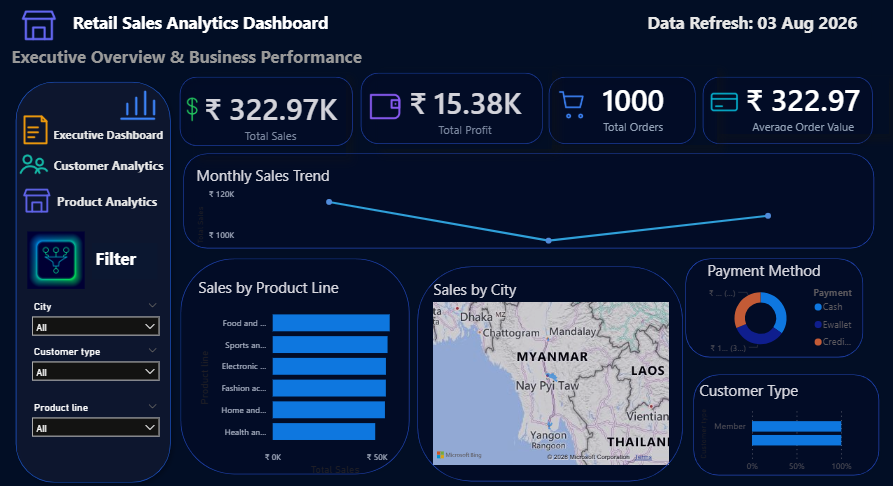

# 📊 Retail Sales Analytics Dashboard | Power BI

> An interactive 3-page Power BI dashboard designed to analyze **retail sales performance, customer behavior, product performance, and profitability** through business-focused KPIs and advanced data visualizations.

---

## 📌 Project Overview

The **Retail Sales Analytics Dashboard** is an end-to-end Business Intelligence project developed using **Microsoft Power BI**.

The objective of this project is to transform raw retail sales data into an interactive analytical solution that helps business stakeholders understand:

- 📈 Overall sales and profitability
- 👥 Customer purchasing behavior
- 🛍️ Product and product-line performance
- 🌍 Geographic sales distribution
- 💳 Payment method and customer-type trends
- 📅 Monthly sales patterns
- 💰 Profitability and profit-margin performance

The dashboard consists of **three interactive analytical pages**, each designed for a specific business perspective.

---

# 🎯 Business Objectives

The dashboard was developed to answer key business questions such as:

- What is the overall sales and profit performance?
- Which product line generates the highest revenue?
- Which city contributes the most sales?
- Which customer type generates higher revenue?
- How does customer satisfaction relate to sales?
- Which products contribute the most revenue and profit?
- How is profit margin performing against the target?
- Are there noticeable monthly or seasonal sales patterns?

---

# 📊 Dashboard Overview

The project contains **3 interactive dashboard pages**:

| Dashboard | Purpose |
|-----------|---------|
| 🏢 **Executive Dashboard** | Overall business performance |
| 👥 **Customer Analytics** | Customer behavior and satisfaction |
| 🛍️ **Product Analytics** | Product performance and profitability |

---

# 📸 Dashboard Preview

## 🏢 Executive Dashboard

## 👥 Customer Analytics

## 🛍️ Product Analytics

---

## 🏢 1. Executive Dashboard

Provides a high-level overview of the organization's overall retail performance.

### 📌 Key Performance Indicators

- 💰 **Total Sales**
- 💵 **Total Profit**
- 🧾 **Total Orders**
- 🛒 **Average Order Value**

### 📊 Visualizations

- 📈 Monthly Sales Trend — Line Chart
- 🛍️ Sales by Product Line — Bar Chart
- 🌍 Sales by City — Map
- 💳 Payment Method Distribution — Donut Chart
- 👥 Customer Type Distribution — Donut Chart

### 🎯 Business Purpose

The Executive Dashboard provides decision-makers with a quick overview of business performance and highlights major sales trends and revenue contributors.

---

## 👥 2. Customer Analytics

The Customer Analytics dashboard focuses on customer behavior, engagement, satisfaction, and purchasing patterns.

### 📌 Key Performance Indicators

- 👥 **Total Customers / Transactions**
- ⭐ **Average Customer Rating**
- 🛒 **Average Basket Size**

### 📊 Visualizations

- 🎀 Customer Type Sales Trend — Ribbon Chart
- ⭐ Average Customer Rating — Gauge Chart
- 📍 Rating vs Sales by City — Scatter Chart
- 🌍 Sales by Customer Location — Map
- 🔥 Monthly Customer Revenue — Heatmap

### 🎯 Business Purpose

This dashboard helps identify customer segments, understand purchasing behavior, analyze customer satisfaction, and discover relationships between customer ratings and sales performance.

---

## 🛍️ 3. Product Analytics

The Product Analytics dashboard evaluates product performance, revenue contribution, and profitability.

### 📌 Key Performance Indicators

- 💰 **Total Sales**
- 📦 **Total Products Sold**
- 🏷️ **Average Product Price**
- 📈 **Profit Margin %**

### 📊 Visualizations

- 🌳 Product Revenue Contribution — Treemap
- 💧 Profit Contribution by Product Line — Waterfall Chart
- 🔍 Sales Decomposition Explorer — Decomposition Tree
- 🎯 Profit Margin Achievement — Gauge Chart
- 🔥 Monthly Product Sales — Heatmap

### 🎯 Business Purpose

This dashboard helps identify high-performing product lines, understand profit contribution, analyze sales drivers, and monitor profitability.

---

# 🧮 DAX Measures

Several DAX measures were created to support KPI calculations, business analysis, and time-based comparisons.

### 📌 Core Measures

``DAX
Total Sales
Total Profit
Total Orders
Total Quantity
Average Order Value
Average Product Price
Average Basket Size
Average Customer Rating
Profit Margin %

Time Intelligence Measures
Running Total Sales
Month-to-Date (MTD) Sales
Previous Month Sales
Previous Year Sales
YoY Growth %

These measures enabled dynamic KPI cards, trend analysis, cumulative sales analysis, and period-over-period comparisons.

🧱 Data Modeling

A Star Schema was implemented to create a structured and efficient Power BI data model.

⭐ Model Structure
                ┌──────────────┐
                │   DimDate    │
                └──────┬───────┘
                       │
                       │ 1 : *
                       ▼
                ┌──────────────┐
                │  FactSales   │
                └──────────────┘
Fact Table

FactSales

Contains transactional sales information and measurable business values.

Dimension Table

DimDate

Contains date-related attributes used for:

Year
Month
Month Number
Time Intelligence
Monthly trend analysis
Relationship
DimDate[Date]  1 ───────── *  FactSales[Date]

A one-to-many relationship was implemented between the Date dimension and the Fact table.

🔄 Data Preparation | Power Query

Power Query was used to prepare the dataset before building the analytical model.

Data Preparation Activities
🔍 Data quality validation
🔢 Data type verification
📅 Date transformation
⚠️ Error checking
🧹 Data cleaning
📊 Column profiling
📆 Date dimension preparation
Data Quality Results
Data Quality Check	Result
Total Rows	~1,000
Total Columns	17
Null Values	0
Duplicate Records	0
Column Validity	100%

The dataset was validated before proceeding to data modeling and visualization.

📈 Key Business Insights

The analysis generated several useful business insights.

🥇 Product Line Performance

Food and Beverages emerged as the highest revenue-generating product line.

🌍 Geographic Performance

Yangon contributed the largest share of sales among the analyzed cities.

👥 Customer Segment

Member customers generated higher revenue compared with Normal customers.

💰 Profitability

The overall profit margin is approximately 4.76%, which is close to the defined business target.

📅 Sales Trends

Monthly sales fluctuate across product lines, indicating variations in purchasing patterns and potential seasonal demand.

🎯 Business Value

These insights can help stakeholders make better decisions related to:

Product strategy
Customer segmentation
Regional sales performance
Pricing
Profitability
Sales planning
🛠️ Tools & Technologies
Technology	Purpose
🟨 Microsoft Power BI	Dashboard development & visualization
🔄 Power Query	Data cleaning & transformation
🧮 DAX	Measures & analytical calculations
🧱 Data Modeling	Star Schema & relationships
📅 Time Intelligence	Period-based analysis
📊 Excel	Source dataset
📊 Power BI Visualizations Used

This project demonstrates a variety of Power BI visualizations beyond basic charts.

📈 Line Chart
📊 Bar Chart
🌳 Treemap
💧 Waterfall Chart
🎀 Ribbon Chart
🔍 Decomposition Tree
🎯 Gauge Chart
🔥 Heatmap
🌍 Map
⭐ KPI Cards
🎛️ Interactive Slicers

The combination of these visuals was selected based on the type of business question being analyzed rather than using the same chart type throughout the report.

🎛️ Interactivity

The dashboard includes interactive features designed to improve the user experience.

Interactive Features
🎛️ Slicers
🔗 Synchronized Slicers
📅 Date filtering
🔍 Interactive visual filtering
📊 Cross-filtering between visuals
📄 Multi-page navigation

These features allow users to explore the data from different business perspectives.

🎨 Dashboard Design

The dashboard was designed with a dark-themed business intelligence interface.

Design Principles
Clean visual hierarchy
Consistent KPI cards
Business-focused color usage
Icon-based KPI presentation
Consistent spacing and alignment
Interactive filtering
Clear chart titles
Minimal visual clutter

The objective was to create a dashboard that is not only visually appealing but also easy for business users to interpret.

📸 Dashboard Preview
Executive Dashboard

Customer Analytics

Product Analytics

📁 Project Structure
retail-sales-analytics-powerbi/
│
├── 📊 Dashboard.pbix
│
├── 📗 Retail_Sales_Dataset.xlsx
│
├── 📄 README.md
│
├── 📑 DAX_Measures.md
│
└── 🖼️ images/
    ├── executive_dashboard.png
    ├── customer_analytics.png
    └── product_analytics.png
🚀 Skills Demonstrated

This project demonstrates practical experience in:

Power BI
Power Query
DAX
Data Cleaning
Data Modeling
Star Schema
Relationships
Time Intelligence
KPI Development
Business Intelligence
Data Visualization
Dashboard Design
Business Storytelling
Interactive Reporting
💡 Key Learning Outcomes

Through this project, I strengthened my ability to:

✅ Transform raw data into an analytical dataset

✅ Build a structured Power BI data model

✅ Create reusable DAX measures

✅ Implement time-intelligence calculations

✅ Design interactive multi-page dashboards

✅ Select appropriate visualizations for business questions

✅ Analyze customer and product performance

✅ Translate data into actionable business insights

✅ Present analytical findings through business storytelling

🎓 Portfolio Project

This project was developed as part of my Data Analytics Portfolio to demonstrate practical, end-to-end Business Intelligence skills.

The project combines data preparation, data modeling, DAX, visualization, dashboard design, and business analysis into a single Power BI solution.

👩‍💻 Author
Shagena

Aspiring Data Analyst

📊 SQL | Excel | Python | Pandas | NumPy | Power BI | DAX | Data Analytics
